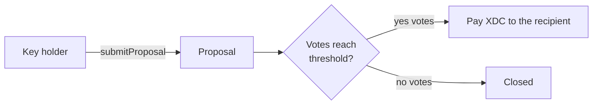

<p align="center">
  
</p>

<p align="center">
  
<a href="https://github.com/CoinClubQuincy/Multi-Sig-Treasury/actions/workflows/build.yml"></a>        
</p>

<p align="center">
  <a href="#how-it-works">How it works</a> · <a href="#try-it">Try it</a> · <a href="#what-is-tested">What is tested</a> · <a href="#known-issues">Known issues</a>
</p>

Each member of the treasury holds a key, which is an ERC-1155 token. Any key holder can propose a payout or a plain vote. When enough keys vote yes, the contract pays out automatically. Because keys are tokens, a seat on the treasury can be moved by transferring its key.

> [!CAUTION]
> Only XDC payouts work today. A passed XRC-20, XRC-721 or XRC-1155 proposal reports success and **moves nothing**. See [Known issues](#known-issues). This contract has not been audited.

## How it works




| Function | What it does |
| --- | --- |
| `constructor(totalKeys, votesNeeded, uri)` | Mints the keys to the deployer, who then hands them out |
| `submitProposal(amount[], address[], topic[])` | Creates a proposal |
| `confirmTransaction(number, vote, key)` | Casts one key's vote and executes at the threshold |
| `revokeConfirmation(number, key)` | Withdraws a vote before the proposal closes |
| `checkVote(key, number)` and `checkTransactionStatus(number)` | Show the state of a vote or proposal |
| `ViewTransactions()` | Lists all proposals |

### Writing a proposal

`topic` must have three strings: `["Topic", "Message", ""]`.

| Proposal | `amount` | `address` |
| --- | --- | --- |
| Plain vote, with no payment | `[0]` | `[0x0000000000000000000000000000000000000000]` |
| Pay XDC | `[amount]` | `[recipient]` |
| XRC-20 (not working yet) | `[amount]` | `[recipient, token]` |
| XRC-721 or XRC-1155 (not working yet) | `[amount, tokenId]` | `[recipient, token]` |

If one address holds several keys, it can vote only with the first one it holds.

## Try it

```bash
git clone https://github.com/CoinClubQuincy/Multi-Sig-Treasury.git
cd Multi-Sig-Treasury
git clone --depth 1 -b v4.9.6 https://github.com/OpenZeppelin/openzeppelin-contracts lib/openzeppelin-contracts
git clone --depth 1 -b v1.9.7 https://github.com/foundry-rs/forge-std lib/forge-std
forge test
```

You need [Foundry](https://getfoundry.sh). Tests named `test_KnownIssue_*` pass because they pin a defect, so a passing run does not mean the defect is gone.

To try it on a network, use the Apothem testnet:

| Network | Chain ID | RPC |
| --- | --- | --- |
| Apothem testnet | 51 | `https://rpc.apothem.network` |
| XDC mainnet | 50 | `https://rpc.xinfin.network` |

```bash
forge create contracts/Multi-Sig-Key.sol:MultiSigTreasury --rpc-url https://rpc.apothem.network --interactive --broadcast --legacy \
  --constructor-args 3 2 "https://example.com/{id}.json"
```

## What is tested

[`test/foundry/MultiSigTreasury.t.sol`](test/foundry/MultiSigTreasury.t.sol) has 7 tests and runs in CI on every push.

| Tested | Not tested |
| --- | --- |
| A 2-of-3 vote releasing XDC | A real network, testnet or mainnet |
| No votes closing a proposal | An independent security audit |
| One vote per key, and revoking a vote | The older `test/testTreasury.js`, which was not run |
| Non-key holders being refused | |

## Known issues

| Issue | Effect | Test |
| --- | --- | --- |
| Token proposals never execute | The proposal stores an empty `call` value, so the transfer branches are never reached. It still emits `Transaction successful!` and the tokens stay put | `test_KnownIssue_PassedTokenProposalMovesNothing` |
| Two topic strings revert | The contract always reads a third entry, despite the older documentation | `test_KnownIssue_TwoTopicStringsRevert` |
| NFT send uses the wrong recipient | `XRC1155_XRC721Send` targets the token contract instead of the recipient. It is unreachable today, and it needs fixing alongside the first issue | Read from the code |
| Function execution is unfinished | The planned call to another contract's function is not implemented | Read from the code |

<details>
<summary><strong>More XDC projects</strong></summary>

| Group | Project | What it is |
| --- | --- | --- |
| Standards | [XRC-SHARES](https://github.com/CoinClubQuincy/XRC-SHARES) | Dividend-paying NFT shares and SPLITS for a DApp |
| Standards | [XRCDividendPlus](https://github.com/CoinClubQuincy/XRCDividendPlus) | Dividend-paying XRC-20 token |
| Treasury and finance | [XRC-Airdrop](https://github.com/CoinClubQuincy/XRC-Airdrop) | Self-run token airdrop |
| Treasury and finance | [XRC-Credit](https://github.com/CoinClubQuincy/XRC-Credit) | Debt contract skeleton |
| Treasury and finance | [XDC-Defi-Instruments](https://github.com/CoinClubQuincy/XDC-Defi-Instruments) | Assets, agreements, forwards, futures and a marketplace |
| Identity and access | [LoginMFAContract](https://github.com/CoinClubQuincy/LoginMFAContract) | Login with a password and an NFT |
| Identity and access | [PrivateAccessToken](https://github.com/CoinClubQuincy/PrivateAccessToken) | Token-gated contract data demo |
| Identity and access | [Delegated_Authority](https://github.com/CoinClubQuincy/Delegated_Authority) | KYC notary proof of concept |
| Learning and libraries | [XDC-LemonadeStand](https://github.com/CoinClubQuincy/XDC-LemonadeStand) | Workshop DApp built on XRC-SHARES |
| Learning and libraries | [Non-Financial-SmartContracts](https://github.com/CoinClubQuincy/Non-Financial-SmartContracts) | Games, inventory, keys and on-chain repositories |
| Tools | [XDC_Python_SDK_V1](https://github.com/CoinClubQuincy/XDC_Python_SDK_V1) | Python client for the XDC JSON-RPC API |
| Tools | [PrivateXDCNode_SetupScript](https://github.com/CoinClubQuincy/PrivateXDCNode_SetupScript) | Private XDC network setup scripts |
| Tools | [WebApp_to_XDCPay](https://github.com/CoinClubQuincy/WebApp_to_XDCPay) | Web app to XDCPay tutorial |
| Multi-chain | [CoinClub_Framework](https://github.com/CoinClubQuincy/CoinClub_Framework) | Python library with an XDC adapter |
| Interfaces | [Contract_Interface_Model_Language](https://github.com/CoinClubQuincy/Contract_Interface_Model_Language) | Interface documents for smart contracts and APIs |

</details>

## License

MIT, as declared in the SPDX headers of the source files. This repository has no separate license file.
