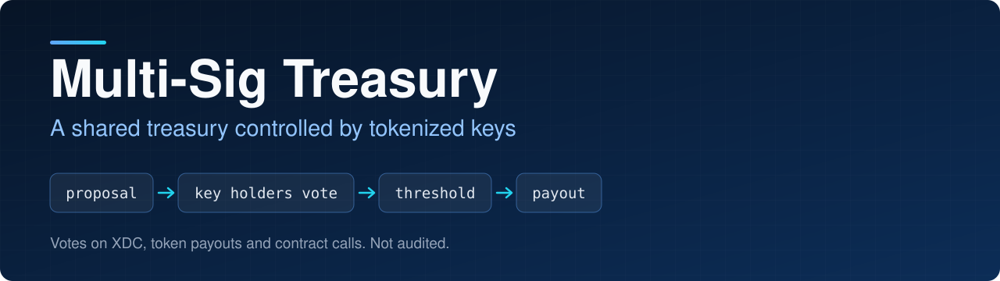
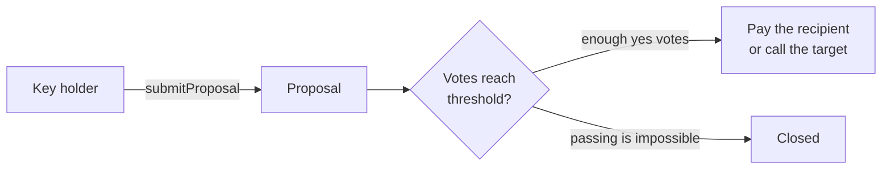

<p align="center">
  
</p>

<p align="center">
  
<a href="https://github.com/CoinClubQuincy/Multi-Sig-Treasury/actions/workflows/build.yml"></a>        
</p>

<p align="center">
  <a href="#how-it-works">How it works</a> · <a href="#try-it">Try it</a> · <a href="#what-is-tested">What is tested</a> · <a href="#known-issues">Known issues</a>
</p>

Each member of the treasury holds a key, which is an ERC-1155 token. Any key holder can propose a payment, a call to another contract or a plain vote. When enough keys vote yes, the contract carries it out automatically. Because keys are tokens, a seat on the treasury can be moved by transferring its key.

> [!CAUTION]
> This contract has not been audited and has not run on a real network. Call proposals can do anything the keys vote for, including sending away the whole treasury. See [Known issues](#known-issues).

## How it works




| Function | What it does |
| --- | --- |
| `constructor(totalKeys, votesNeeded, uri)` | Mints the keys to the deployer, who then hands them out |
| `submitProposal(amount[], address[], topic[])` | Creates a payment proposal or a plain vote |
| `submitCallProposal(target, value, data, topic, message)` | Creates a proposal to call another contract |
| `confirmTransaction(number, vote, key)` | Casts one key's vote and executes at the threshold |
| `revokeConfirmation(number, key)` | Withdraws a vote before the proposal closes |
| `checkVote(key, number)` | Shows how a key voted |
| `checkTransactionStatus(number)` | Shows whether a proposal is closed, whichever way it went |
| `checkTransactionExecuted(number)` | Shows whether a proposal passed and was carried out |
| `ViewTransactions()` | Lists all proposals |

### Writing a proposal

`topic` is `["Topic", "Message"]`. A third entry is accepted and ignored, so older callers keep working. The shape of the other two arrays picks the proposal:

| Proposal | `amount` | `address` |
| --- | --- | --- |
| Plain vote, with no payment | `[0]` | `[0x0000000000000000000000000000000000000000]` |
| Pay XDC | `[amount]` | `[recipient]` |
| XRC-20 | `[amount]` | `[recipient, token]` |
| XRC-721 or XRC-1155 | `[amount, tokenId]` | `[recipient, token]` |

For an XRC-721 the amount is ignored, so use `1`. The contract asks the token which standard it follows, and refuses the payout if the token does not say.

To call another contract, encode the function and its arguments off-chain and pass them as `data`. Each proposal makes one call.

A proposal closes as soon as it can no longer pass. With 5 keys and 2 votes needed, that takes 4 no votes. If a payout or call fails, the vote that triggered it reverts and the proposal stays open.

An address holding several keys can vote with each of them, one vote per key.

A vote counts only while the voter still holds that key. If the key moves, its vote stops counting and the new holder can cast their own. If the key returns before then, the old vote counts again. Each proposal also expires 30 days after it is created.

## Try it

```bash
git clone https://github.com/CoinClubQuincy/Multi-Sig-Treasury.git
cd Multi-Sig-Treasury
git clone --depth 1 -b v4.9.6 https://github.com/OpenZeppelin/openzeppelin-contracts lib/openzeppelin-contracts
git clone --depth 1 -b v1.9.7 https://github.com/foundry-rs/forge-std lib/forge-std
forge test
```

You need [Foundry](https://getfoundry.sh).

To try it on a network, use the Apothem testnet:

| Network | Chain ID | RPC |
| --- | --- | --- |
| Apothem testnet | 51 | `https://rpc.apothem.network` |
| XDC mainnet | 50 | `https://rpc.xinfin.network` |

```bash
forge create contracts/Multi-Sig-Key.sol:MultiSigTreasury --rpc-url https://rpc.apothem.network --interactive --broadcast --legacy \
  --constructor-args 3 2 "https://example.com/{id}.json"
```

## What is tested

[`test/foundry/MultiSigTreasury.t.sol`](test/foundry/MultiSigTreasury.t.sol) has 29 tests, including one fuzz test, and runs in CI on every push.

| Tested | Not tested |
| --- | --- |
| XDC, XRC-20, XRC-721 and XRC-1155 payouts reaching the right recipient, using real tokens | A real network, testnet or mainnet |
| Call proposals, with and without value | An independent security audit |
| A failed payout or call reverting the deciding vote | |
| A recipient trying to vote again while being paid | |
| Votes on proposals that do not exist | |
| Closing only once passing is impossible | |
| One vote per key, voting with several keys, moving a key after voting, and revoking a vote | |
| One person voting with several keys and handing them out to pass a proposal alone | |
| Proposals expiring | |
| Non-key holders being refused, and bad constructor values | |
| Fuzz: a payout moves exactly the approved amount | |

## Changes from earlier versions

Contracts already deployed are unaffected and keep the old behaviour.

- Token proposals now execute. They used to report success and move nothing.
- `topic` now needs only two strings. The third is optional.
- NFT payouts go to the recipient instead of the token contract.
- New function `submitCallProposal`, and new view `checkTransactionExecuted`.
- `ViewTransactions` returns two more fields on each proposal: `executed` and `data`.
- `checkTransactionStatus`, `checkVote` and `ViewTransactions` are now `view`.
- The constructor refuses zero keys and a threshold of zero.
- A proposal now closes only when passing is impossible. It used to close once no votes outnumbered the threshold.
- A failed XDC payout now reverts, and voting on a proposal that does not exist is refused.
- A vote now counts only while its voter holds the key. Before, a vote kept counting after the key was handed on, so one person could vote with several keys, hand them out and pass a proposal alone. A new holder can now replace the old vote.
- Only a yes vote can carry a proposal, and only a no vote can close it.
- Proposals expire after 30 days (`PROPOSAL_LIFETIME`, `proposalExpiry`).
- The older Truffle test and tracked build output were removed. Foundry is the supported test path.

## Known issues

| Issue | Effect |
| --- | --- |
| Keys can vote for anything | A passed call proposal can move every asset the treasury holds. Check the target and `data` before voting |
| A call to an address with no code succeeds | The low-level call reports success, so a mistyped target passes silently |
| Proposal checks are only made when it is created | Funds can change before the vote finishes, in which case the deciding vote reverts until the treasury is refilled |
| Each vote recounts every key | Gas grows with the number of keys, so a treasury with a very large key count would become expensive to vote in |
| Totals can lag behind key moves | The `pass` and `fail` totals in `ViewTransactions` update at the next vote or revoke, and a proposal only executes on a yes vote, even if a key moving has already brought it to the threshold |
| `checkVote` can show an old vote | It shows the last vote cast with a key, even after the key has moved and that vote has stopped counting |
| `ViewTransactions` reads every proposal | It gets slower as proposals pile up. It is meant for off-chain reads |

<details>
<summary><strong>More XDC and EVM projects</strong></summary>

| Group | Project | What it is |
| --- | --- | --- |
| Standards | [XRC-SHARES](https://github.com/CoinClubQuincy/XRC-SHARES) | Dividend-paying NFT shares and SPLITS for a DApp |
| Standards | [XRCDividendPlus](https://github.com/CoinClubQuincy/XRCDividendPlus) | Dividend-paying XRC-20 token |
| Treasury and finance | [XRC-Airdrop](https://github.com/CoinClubQuincy/XRC-Airdrop) | Self-run token airdrop |
| Treasury and finance | [XRC-Credit](https://github.com/CoinClubQuincy/XRC-Credit) | Single-loan credit contract |
| Treasury and finance | [XDC-Defi-Instruments](https://github.com/CoinClubQuincy/XDC-Defi-Instruments) | Assets, agreements, forwards, futures and a marketplace |
| Treasury and finance | [XRC1155-Equities-Market](https://github.com/CoinClubQuincy/XRC1155-Equities-Market) | Shares, portfolios and a marketplace on ERC-1155 |
| Treasury and finance | [NFTOTC](https://github.com/CoinClubQuincy/NFTOTC) | Over-the-counter sale of a token collection |
| Treasury and finance | [DAppProxySwap](https://github.com/CoinClubQuincy/DAppProxySwap) | Currency swaps for a DApp through a fixed router |
| Identity and access | [LoginMFAContract](https://github.com/CoinClubQuincy/LoginMFAContract) | Login with an NFT and a signed second factor |
| Identity and access | [PrivateAccessToken](https://github.com/CoinClubQuincy/PrivateAccessToken) | Token access to encrypted off-chain data |
| Identity and access | [Delegated_Authority](https://github.com/CoinClubQuincy/Delegated_Authority) | KYC notary proof of concept |
| Identity and access | [EncryptedNFT-Documents](https://github.com/CoinClubQuincy/EncryptedNFT-Documents) | NFTs tied to encrypted off-chain documents |
| Learning and libraries | [XDC-LemonadeStand](https://github.com/CoinClubQuincy/XDC-LemonadeStand) | Workshop DApp built on XRC-SHARES |
| Learning and libraries | [Non-Financial-SmartContracts](https://github.com/CoinClubQuincy/Non-Financial-SmartContracts) | Games, inventory, keys and on-chain repositories |
| Learning and libraries | [ContractLedger](https://github.com/CoinClubQuincy/ContractLedger) | On-chain list of contract addresses |
| Learning and libraries | [TimestampConverter](https://github.com/CoinClubQuincy/TimestampConverter) | Timestamps to calendar dates in Solidity |
| Tools | [XDC_Python_SDK_V1](https://github.com/CoinClubQuincy/XDC_Python_SDK_V1) | Python client for the XDC JSON-RPC API |
| Tools | [PrivateXDCNode_SetupScript](https://github.com/CoinClubQuincy/PrivateXDCNode_SetupScript) | Private XDC network setup scripts |
| Tools | [WebApp_to_XDCPay](https://github.com/CoinClubQuincy/WebApp_to_XDCPay) | Working web app connected to XDCPay |
| Multi-chain | [CoinClub_Framework](https://github.com/CoinClubQuincy/CoinClub_Framework) | Python library with an XDC adapter |
| Interfaces | [Contract_Interface_Model_Language](https://github.com/CoinClubQuincy/Contract_Interface_Model_Language) | Interface documents for smart contracts and APIs |

</details>

## License

[MIT](LICENSE).
